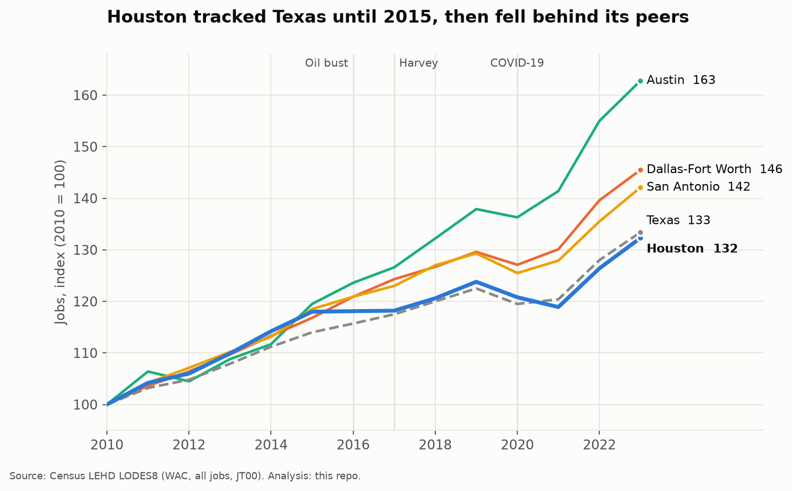
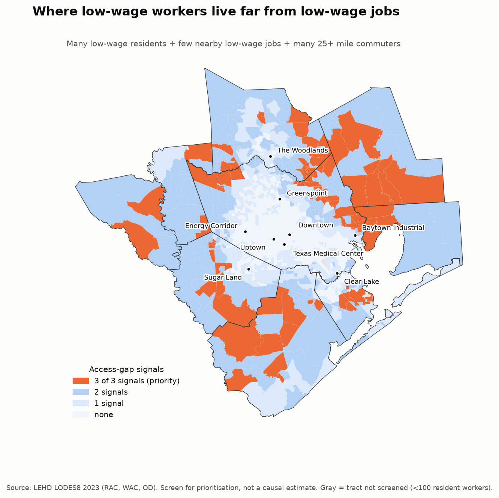
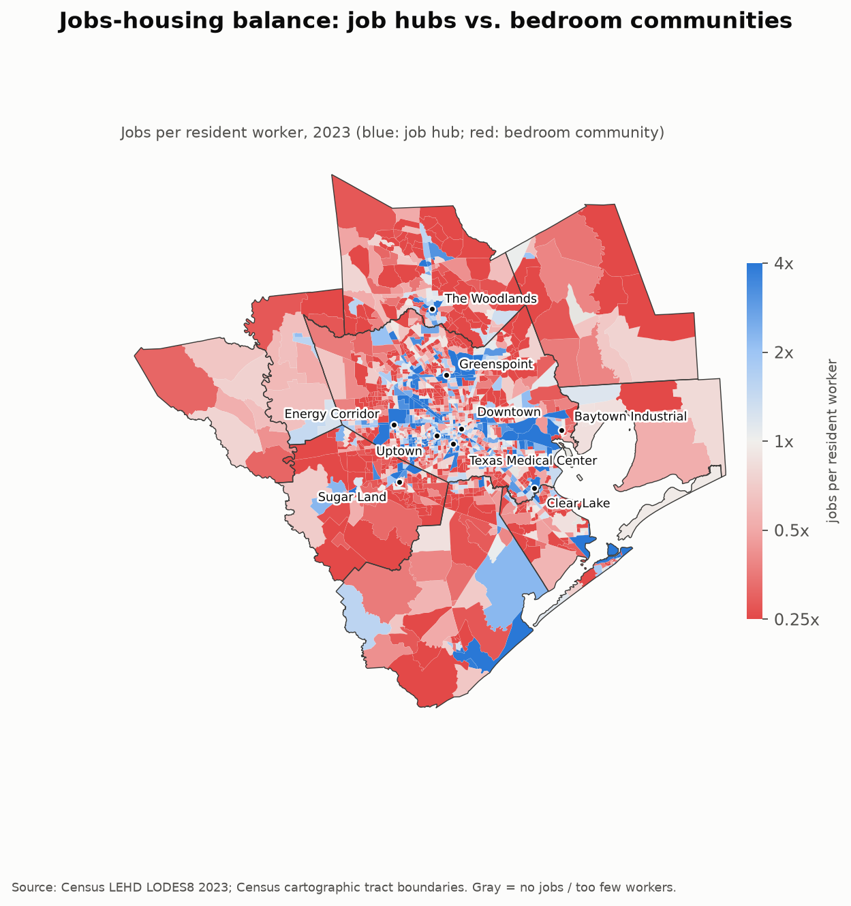

# Houston Employment & Commute Analysis (Census LODES, 2010-2023)

**End-to-end data analytics project:** 450 MB of raw Census LEHD LODES8 block-level files → validated tract-level tables (Python) → SQLite star schema → 22 analytical SQL queries → static charts, choropleths and an interactive map → a policy recommendation.

> **Business question:** *Where should the Houston region target workforce-access investment, given how its jobs and commutes have changed since 2010?*

**Answer in one paragraph.** Houston kept pace with Texas until the 2015 oil bust, then lagged Dallas-Fort Worth, Austin and San Antonio (2019-23 job growth: **+6.9%** vs +12.3% / +18.0% / +9.8%). The economy is diversifying healthily away from energy (mining jobs **-35%** since 2014, yet industry concentration is unchanged), but growth has shifted to the suburbs - Harris County grew **4.5%** since 2019 vs **20.5%** in Montgomery and **16.1%** in Fort Bend - so commutes are getting longer and more regional. A three-signal screen finds **93 tracts holding ~50,000 low-wage workers** who live far from low-wage jobs; these, concentrated in Harris, Montgomery, Fort Bend, Galveston, Brazoria and Liberty counties, are where commuter-access pilots and suburban job-anchoring would reach the most people. → [Policy brief](outputs/reports/policy_brief.md)

| | |
|---|---|
|  |  |

## What's in the repo

```
src/           download_data.py → clean.py → build_db.py → run_sql.py → visualize.py (+ make_notebooks.py, config.py)
sql/           00_setup … 05_spatial_mismatch  - 6 files, 22 exported queries + 6 setup blocks
notebooks/     01 cleaning & QA · 02 SQL analysis · 03 geo-viz & recommendation  (executed, outputs embedded)
outputs/       tables/*.csv (query results) · figures/*.png (11) · maps/houston_jobs_interactive.html · reports/
docs/          METHODOLOGY.md · INTERVIEW_GUIDE.md
data/processed houston_msa_wac_tract_panel.csv.gz  (raw & interim data and the SQLite db are git-ignored; `make all` rebuilds them)
tests/         11 pytest checks (unit tests + data-integrity tests against the built database)
```

## Findings

| # | Finding | Evidence |
|---|---|---|
| 1 | Houston lagged peers after the oil bust | 2019-23 CAGR 1.7% vs 2.9% DFW, 4.2% Austin; 2016-17 job growth ≈ 0 while mining fell 13-15%/yr |
| 2 | Diversification is working | Growth from professional/tech (+42k), health (+37k), logistics (+27k); HHI flat at ~760 (DFW 749) |
| 3 | Growth is suburban | Harris 76% of jobs but +4.5% since 2019; Chambers +24.6%, Waller +22.5%, Montgomery +20.5%, Fort Bend +16.1% |
| 4 | Job centers are shifting | The Woodlands +71%, Sugar Land +56% since 2010 vs Downtown +7%, Galleria +1%; 20-35 mi job ring 15.4% → 22.1% |
| 5 | Commutes are more regional | Workers with 25+ mi to work 22.5% → 26.9% (2015-23); Harris inbound share 32.5% → 37.1% |
| 6 | Stranded low-wage workers | 93 priority tracts / 49.7k workers; low-wage jobs per worker within 10 mi: Liberty 0.48, Brazoria 0.70, Harris 1.15 |



Explore the tract-level [interactive map](outputs/maps/houston_jobs_interactive.html) (download and open in a browser; toggle job density / job change / access-gap layers, hover for tract stats).

## Tech and skills demonstrated

* **Python** - pandas, numpy, geopandas, matplotlib, folium; typed, modular `src/` package; pytest.
* **SQL (SQLite)** - CTEs, window functions (`LAG`, `FIRST_VALUE`, `NTILE`, `ROW_NUMBER`, `SUM() OVER`), conditional-aggregation pivots, self-joins, spatial joins with bounding-box prefilters, UDFs, indexing and a denormalisation that took one query from 294 s to 0.5 s.
* **Data engineering** - reproducible download → clean → load pipeline, idempotent downloads, `Makefile`, star schema, 31-file automated data-quality audit (`outputs/reports/data_quality.md`).
* **Analytics** - location quotients, HHI, CAGR, shift analysis around shocks (oil bust, Harvey, COVID), cumulative-opportunity accessibility, quartile screening, jobs-housing balance.
* **Communication** - policy brief with recommendations and explicit caveats; validated colour palette (colour-blind safe), direct-labelled charts.

## Reproduce

```bash
git clone <this repo> && cd tx-employment-lodes
make setup        # venv + pinned dependencies (Python 3.11+)
make all          # download (~450 MB) → clean → build db → SQL → charts/maps → tests   (~10 min)
make notebooks    # re-execute the three notebooks
```

## Data

US Census Bureau, Longitudinal Employer-Household Dynamics, **LODES version 8** (Texas): WAC (jobs by workplace), RAC (workers by residence), OD (home→work flows), geography crosswalk; Census cartographic boundary files (2023). LODES is public domain. See [docs/METHODOLOGY.md](docs/METHODOLOGY.md).

## Limitations (short version)

Wage bands are fixed nominal dollars (used cross-sectionally only); OD distances are straight-line to the employer-assigned address (remote workers inflate long-distance shares after 2020); OD covers in-state, UI-covered jobs only; LODES has block-level noise (analysis is tract-level); the access-gap screen prioritises where to look and is not causal. Details in the [policy brief](outputs/reports/policy_brief.md#caveats-read-before-quoting-numbers) and [methodology](docs/METHODOLOGY.md).
